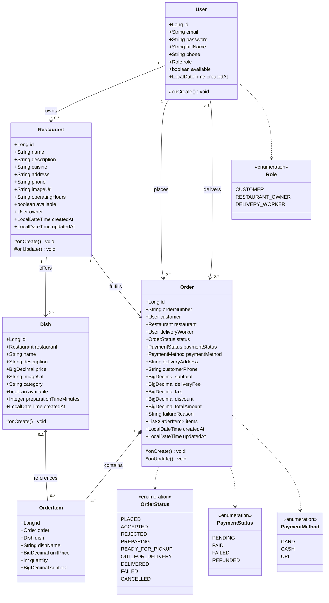
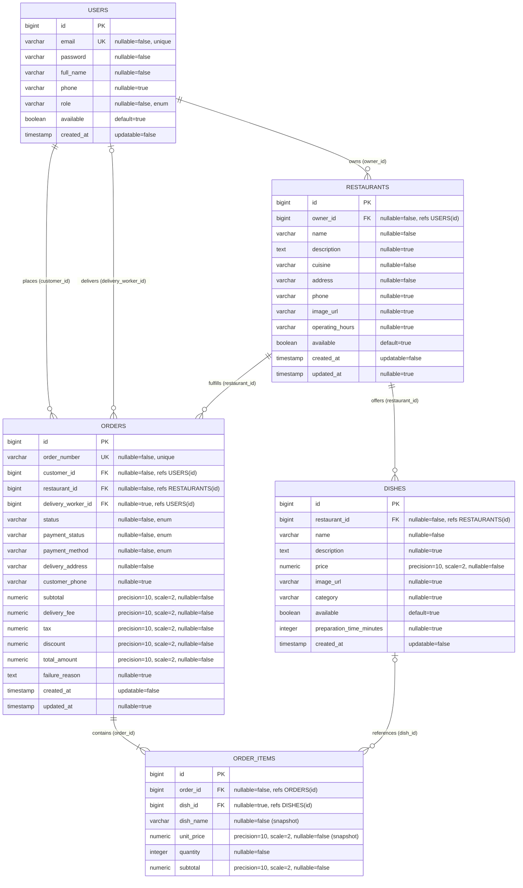
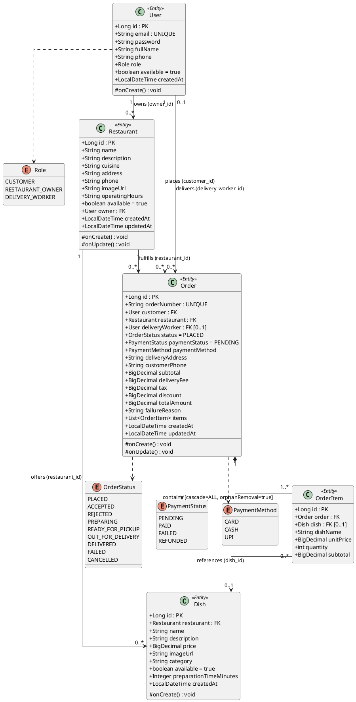
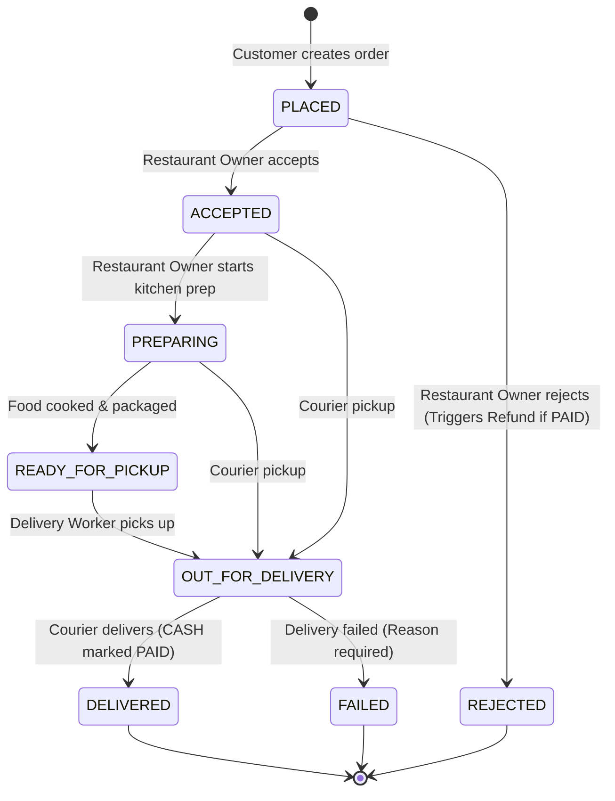

# Muncho Backend — Data Model UML & Relationship Specification

This document provides the UML Class Diagram, Entity-Relationship (ER) Diagram, and detailed structural specifications for all entities and relationships in the **Muncho Backend** application (`com.muncho.backend.model`).

---

## 1. UML Class Diagram (Mermaid)

---

## 2. Entity-Relationship (ER) Diagram

---

## 3. PlantUML Class Diagram Representation

For IDE plugins (IntelliJ PlantUML viewer, VS Code PlantUML):

---

## 4. Relationship Details & Multiplicity Matrix

| Relationship | Source Entity | Target Entity | Foreign Key Column | Cardinality | Cascade / Lifecycle Rules | Description |
| :--- | :--- | :--- | :--- | :--- | :--- | :--- |
| **Owner Ownership** | `Restaurant` | `User` | `owner_id` (NOT NULL) | `Restaurant` N:1 `User` | Fetch: `LAZY` | A user with role `RESTAURANT_OWNER` can own multiple restaurants. |
| **Menu Offering** | `Dish` | `Restaurant` | `restaurant_id` (NOT NULL) | `Dish` N:1 `Restaurant` | Fetch: `LAZY` | Every dish belongs strictly to one restaurant. |
| **Customer Placement** | `Order` | `User` | `customer_id` (NOT NULL) | `Order` N:1 `User` | Fetch: `LAZY` | A customer (`CUSTOMER` role) places 0 or more orders. |
| **Order Fulfillment** | `Order` | `Restaurant` | `restaurant_id` (NOT NULL) | `Order` N:1 `Restaurant` | Fetch: `LAZY` | An order is prepared by exactly 1 restaurant. |
| **Delivery Assignment** | `Order` | `User` | `delivery_worker_id` (NULLABLE) | `Order` N:0..1 `User` | Fetch: `LAZY` | An order can be assigned to at most 1 delivery courier (`DELIVERY_WORKER` role). Unassigned on creation. |
| **Order Composition** | `Order` | `OrderItem` | `order_id` (NOT NULL) | `Order` 1:N `OrderItem` | `CascadeType.ALL`, `orphanRemoval=true` | Strict composition: lifecycle of `OrderItem` is bound to `Order`. Deleting an order deletes its line items. |
| **Historical Dish Link** | `OrderItem` | `Dish` | `dish_id` (NULLABLE) | `OrderItem` N:0..1 `Dish` | Fetch: `LAZY` | Optional reference to catalog dish. Retains `dishName` & `unitPrice` snapshots to preserve financial integrity if dishes are deleted or re-priced. |

---

## 5. Order Status Lifecycle (State Transition Diagram)

The relationships between `User` (Customer, Owner, Delivery Worker) and `Order` govern the order state transitions:

